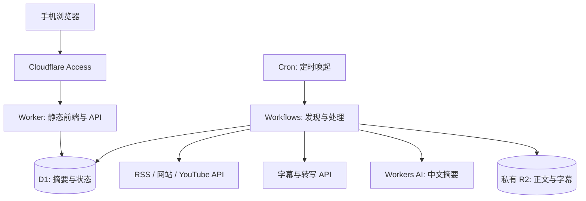

# 用 Cloudflare 托管采集、摘要和阅读网站

版本 0.2 · 2026-10-08 · 第一轮修订，尚未进行真实来源测试

一个代码仓库、一个全栈 Worker 部署入口。前端静态资源和后端 API 同域，后台定时采集独立于用户打开网页的请求。数据和任务运行在 Cloudflare，音视频正文通过公开 feed 和可替换的数据服务获取。

产品行为以 [PRD](prd.md) 为准。下面依次说明运行架构、内容获取、处理恢复、数据与 API、安全和部署。

## 1. 网站、数据库和任务都在 Cloudflare

| 部件 | 选择与职责 |
| --- | --- |
| 手机前端 | React + Vite + TypeScript，单页响应式应用；通过 Workers Static Assets 托管 |
| 后端 | TypeScript + Hono，提供同源 JSON API、管理入口、定时事件和 Workflow 类 |
| 数据库 | D1，保存人物、来源、条目、中文摘要、收藏、运行状态 |
| 原文存储 | 私有 R2，保存清洗正文、带时间的字幕及抓取版本；不长期存音视频 |
| 定时执行 | Cron Triggers 负责唤起；Workflows 负责分步执行、等待、重试与恢复 |
| 中文处理 | Workers AI，抽取、分类、摘要使用同一接口；首批样本验收后锁定模型 |
| 登录 | Cloudflare Access，单人白名单，网页与 API 一起保护 |
| 外部数据 | YouTube Data API 提供频道/搜索元数据；Supadata 作为字幕与长音频转写的首选验证对象 |

静态前端与 API 可以在一个 Worker 项目中部署，[Static Assets 官方说明](https://developers.cloudflare.com/workers/static-assets/billing-and-limitations/)分别计算静态资源与 Worker 请求。此规模用同域部署可减少跨域认证及两个发布入口的维护。第一版不增加 Pages、Queues、KV、向量库或独立容器。

阅读路径：手机通过 Access 登录，访问静态页面；页面向 Worker 取数据，Worker 读取 D1。采集路径：Cron 唤起工作流，工作流获取正文、调用模型、将全文写入 R2、摘要及索引写入 D1。

“全 Cloudflare 托管”指应用计算、存储、定时任务和页面均在 Cloudflare。首版仍调用第三方内容 API；关闭本地电脑不会影响运行。若要求所有音频推理也在 Cloudflare，需要另做音频获取、解码和分段处理，作为独立范围调整。

[开源项目比较](landscape.md#2-开源项目优先判断能复用什么)支持沿用轻量 Worker 方案。Briefings 可作为接口与来源状态参考；其截断正文、四队列和邮件周报设计不直接移植。现阶段没有选定需要复制的模块；实现时固定版本、保留许可说明后再决定是否复用。

## 2. 每类来源先找稳定入口，再处理正文

**YouTube。** 导入时将频道 URL 解析为稳定 channel ID 和 uploads playlist ID，每日分页读取新上传项；恢复时回看七天并按 video ID 去重。完整历史回补使用 [playlistItems.list](https://developers.google.com/youtube/v3/docs/playlistItems/list)，不会只依赖有限长度的近期 feed。

第三方访谈每天对人物姓名、别名和必要的公司标识做有限查询。初期每人至多两次请求，默认每次最多检查 20 个结果，查最近七天；再核实描述、嘉宾介绍和正文中的身份。结果不确定时保留为候选。官方 [search.list](https://developers.google.com/youtube/v3/docs/search/list) 提供视频搜索，实际配额以该部署账号为准；不以搜索结果条数计算全网召回率。

官方 [captions.download](https://developers.google.com/youtube/v3/docs/captions/download) 要求调用者具有视频编辑权限。因此第三方字幕先验证 Supadata；使用 `mode=native` 只取已有字幕，需要生成转写时走单独的费用判断，避免默认 `auto` 隐式增加成本。保留时间片段及原始语言，由自己的摘要步骤输出中文。[接口说明](https://docs.supadata.ai/get-transcript)

**Podcast。** RSS 的 GUID 标识 episode，`enclosure` 定位公开音频；优先读取 [podcast:transcript](https://podcasting2.org/docs/podcast-namespace/tags/transcript) 或节目官网完整逐字稿。Show notes 只能作为简介。缺少逐字稿时，将公开音频 URL 交给转写服务，不让 Worker 缓冲整段音频。Supadata 文档支持 MP3/M4A 等公开文件及异步任务；实际 feed 的跳转、格式和长音频可用性必须用样本验证。[文件转写说明](https://docs.supadata.ai/get-transcript)

首版单集转写预算上限 180 分钟，月度总量见计划；超限只保留链接。服务未稳定支持的来源不临时绕回本机 cron。Workers AI [Whisper 模型](https://developers.cloudflare.com/workers-ai/models/whisper-large-v3-turbo/)及[大音频分段示例](https://developers.cloudflare.com/workers-ai/guides/tutorials/build-a-workers-ai-whisper-with-chunking/)保留为以后降低转写费用的路径，首版不建设这条媒体处理链。

**网站和公开 newsletter。** RSS/Atom 提供增量入口；正文优先使用 feed 全文，否则抓取原站文章，清洗导航与推广。无 feed 时只检查已登记的文章列表页，并限制页面数与允许域名。订阅墙、邮件专属内容及动态页面解析失败时记录原因，后续按真实名单决定是否增加连接器。

所有来源采用条件请求 ETag/Last-Modified；尊重服务访问限制和限流。来源页面、字幕和模型输出均为不可信数据，不从正文执行指令或工具调用。原文缓存期限按来源政策配置，默认短期留存，不在公开仓库或公开 R2 中再发布全文。

采集器使用两个内部方法：发现条目与取得内容。各自返回能力及限制，区分 metadata、正文、时间片段和付费转写；这是内部接口，不建设通用插件系统。暂不接入 RSSHub 或浏览器抓取作为第二套常驻采集基础设施。

## 3. 先发现，再独立处理每条内容

用两类 Workflow 即可：`DailyScan` 按来源检查、登记候选；`ProcessItem` 为每条新内容获取正文并生成摘要。一个来源失败，其他来源继续完成。任务结果可随时从 D1 查询，网页不等待整天任务结束。

定时器每小时唤起一次，按业务时区判断是否已经过 06:00，使用本地日期唯一键启动当日扫描。其余唤起只做有上限的失败恢复、未启动任务补偿和日状态汇总；每个来源每天正常检查一次。这样既处理漏触发，也避免夏令时导致一天运行两次。[Cloudflare Cron 使用 UTC](https://developers.cloudflare.com/workers/configuration/cron-triggers/)，业务时间转换必须有 DST 测试。

单条管线：发现 → URL/平台 ID 去重 → 初筛 → 正文获取 → 身份与一手核验 → 经营信息抽取 → 中文摘要与分类 → 规则校验 → 写入阅读列表。不相关或身份不确定的条目保留原因；只能取得元数据的条目保持待补全文。

长稿按语义段落切块，每块约 6,000–8,000 tokens 并保留原始位置，再合并抽取结果生成最终摘要。完整材料全部覆盖；超过配置上限时标注部分处理，不静默截断。首选验证模型为 Workers AI 的 Llama 3.3 70B FP8 Fast，其当前上下文窗口为 24,000 tokens；只是成本基线，中文与事实准确率仍以样本验收为准。[模型说明](https://developers.cloudflare.com/workers-ai/models/llama-3.3-70b-instruct-fp8-fast/)

为每份材料保存 `retrieved_chars`、`processed_chars`、`truncated`、`coverage_basis`、`has_timestamps` 和 `processed_ranges`。音频有时长时检查转写起止范围，网站正文结合文章结构和抽取诊断；这些信号用于发现截断，不单凭文本长度推断完整。外部 API 的 HTTP 200 只说明请求成功。未经确认的覆盖范围保持 `partial`，禁止提升为完整摘要。

模型只输出符合约定的 JSON：相关性、人物关系、主类、标签、要点、结果主张、证据位置、缺失信息。Schema、合法枚举、证据片段存在性、数字口径和时间范围由代码校验。失败可修复一次；仍不合格则待复核。第一版不用 LLM 判断任务是否成功，也不让 LLM 自行调用采集工具。

## 4. 重试、去重和费用控制必须一起设计

发现时按稳定平台 ID 去重；Podcast 使用 feed ID + GUID，无 GUID 才回退规范化 enclosure URL。文章保留原 URL 并去掉已知跟踪参数，不能随意删除有内容语义的查询参数。处理前已确认同组且正文一致时复用摘要；处理后才确认同组则合并展示，不保证消除之前已产生的费用。

处理状态使用 `discovered / queued / fetching / summarizing / ready / partial / metadata_only / excluded / needs_review / failed`；每步保存错误码、重试次数、下次重试时间。仅标题/简介不能进入 `ready`。

D1 的唯一键保护条目、每日任务和处理版本。处理版本由条目 ID、正文 hash、摘要 schema/prompt 版本组成；相同版本重复执行复用结果。Workflow 的步骤恢复不等于外部 API 恰好执行一次，仍要记录 provider job ID。已支付的任务只查询结果；若网络中断导致是否提交成功无法确定，进入待核实，避免无条件重试付费生成。

发现条目后先写 `queued`，再启动确定性 ID 的 Workflow；小时巡检扫描尚未启动的条目补偿这一间隙。成功步骤保存结果引用；后台任务即使中断，也能继续写入原条目。原文修订只新增摘要版本，保留来源与更新时间。

初始并发 3，普通抓取超时 30 秒，每源每轮页面上限可配置；HTML 响应大小先限制到 5 MB。可重试错误最多三次，指数退避并遵守 `Retry-After`；403、付费墙和不支持格式明确记录，不持续重试。长转写用 job ID 异步轮询，每次等待由 Workflow 调度。

调用前在 D1 原子预留 token/转写分钟/credits 预算，调用后按实际用量结算；重试也计入预算。余额不足时继续元数据发现，暂停付费处理。手动重跑复用相同规则，不能绕过预算或幂等键。

跨平台合并使用 `content_group_id`：同集 ID、原站互链等强证据自动合并；模糊标题仅提示人工检查。首版不做向量相似度自动合并。

## 5. D1 保存索引与摘要，R2 保存正文版本

下面是实现级实体草案，字段名可在第一次迁移中调整；关系与保真要求保持一致。

| 实体 | 关键字段与约束 |
| --- | --- |
| `people` | ID、姓名、别名、公司、追踪理由、成果原述、证据 URL、启用状态 |
| `sources` | 类型、规范 URL/平台 ID、ETag、cursor、最近尝试/成功时间、发现/正文/时间戳能力、支持状态、错误 |
| `person_sources` | 人物与来源多对多；关系为本人或访谈监测节目 |
| `items` | 平台 ID/规范 URL 唯一、标题、简介、发布时间、发现时间、日归档、处理状态、来源语言、完整度、内容组 |
| `item_sources` / `item_people` | 条目出处、人物角色（作者/嘉宾/主持人/仅提及）、核验依据 |
| `content_groups` | 主条目、合并依据；各版本原链接独立保留 |
| `documents` | 条目、R2 key、hash、获取方式、内容类型、段落/时间位置、取得/处理长度、截断标记、范围依据、获取和过期时间 |
| `summaries` | 条目 + 处理版本唯一、中文标题、要点、主类、标签、主张及证据 JSON、模型和 prompt 版本 |
| `saved_items` | owner + content group 唯一、收藏时间；保证手机与电脑一致 |
| `runs` / `run_sources` | 本地日期、开始/完成、各来源发现量与失败数、截止状态；未运行也能被 UI 识别 |
| `processing_jobs` / `usage_ledger` | 幂等键、Workflow/provider ID、步骤、重试、预算预留和实际消耗 |

首版不建设全文索引；常用索引覆盖日期、人物、主类、状态和收藏。查询使用游标分页，每页默认 20 条，并设置最大页长。

R2 默认保留完整正文 30 天；清洗结果与 hash 支持复核。展示摘要和必要的短证据片段可以长期保留；来源有更严格要求时采用更短期限或删除策略。音视频直接由提供方处理，成功后不留媒体副本。数据库按日备份到私有存储，保留 7 个恢复点；上线前至少验证一次恢复。

同源 API 草案：

| 接口 | 用途 |
| --- | --- |
| `GET /api/digest?date=&person=&category=&cursor=` | 当日重点、其他相关内容及覆盖状态 |
| `GET /api/items/:id` | 详情、多个原链接、摘要依据和证据 |
| `GET /api/saved` · `PUT/DELETE /api/saved/:groupId` | 查看、收藏、取消收藏 |
| `GET/POST /api/people` · `PATCH /api/people/:id` | 查询、新增、编辑人物 |
| `GET/POST /api/sources` · `PATCH /api/sources/:id` | 查询、登记和启停来源 |
| `POST /api/imports` | 手工补录一个链接或私有名单；返回异步状态 |
| `GET /api/runs` · `POST /api/runs` | 查看运行状态、触发有幂等保护的补跑 |

API 只返回需要阅读的字段，不向浏览器传第三方凭证、账号标识或完整原始抓取响应。候选审核、合并/撤销合并和摘要重试的具体路由在实现时补齐，权限与幂等要求相同。

候选审核属于首版：人物详情可查询该人物相关的待核实/已排除记录，并确认人物关系、拒绝候选、补充原始链接或恢复被排除条目。人工修改留下原因，恢复操作走原有处理版本和费用检查。

## 6. 公开仓库与私有阅读实例分开

公开 Git 只保存代码、通用文档、脱敏配置和虚构 fixture。真实追踪名单从忽略提交的本地文件或站内管理页导入 D1。部署账号、Access 允许的邮箱、密钥和真实资源标识只写私有配置与 Wrangler secrets。

Access 保护生产域名、`workers.dev` 和 preview 入口；Worker 的 API 校验 Access JWT 签名、issuer、audience、过期时间和用户白名单，写操作校验 Origin。官方提示带 Static Assets 的内部路由不会传递 `ctx.access`，因此本设计采用 JWT 校验，不依赖该字段。[Access 限制](https://developers.cloudflare.com/workers/configuration/cloudflare-access/) · [JWT 校验](https://developers.cloudflare.com/cloudflare-one/access-controls/applications/http-apps/authorization-cookie/validating-json/)

只接受已登录管理员登记的 HTTPS 来源。抓取器限制域名、跳转次数、响应大小和内容类型，禁止 localhost、私有/保留地址及重定向到这些地址；不暴露任意 URL 代理。渲染清洗文本或受控 Markdown，链接仅允许 HTTP(S)，避免原站 HTML 或模型文本注入脚本。

日志仅记录 item/source/run ID、错误码、耗时和用量，不记录密钥、原始正文或完整带查询参数的私有 URL。R2 不开放公共访问。日更和手动调用都通过相同的限流与预算逻辑。

## 7. 部署顺序先验证，后启用真实日更

本节是 review 通过后的操作计划；当前没有创建 Cloudflare 资源。

1. **工具与身份。** 在项目中锁定 Wrangler 4.x 和 Node 兼容版本，使用 `wrangler.jsonc`，设置实现当时的 compatibility date，生成绑定类型。通过 `wrangler whoami` 确认账号；过期时执行 `wrangler login`。
2. **隔离环境。** staging 和 production 各有独立 Worker、D1、R2、Workflow 名称与 Access 应用；staging 默认关闭定时触发，用少量样本。实际资源 ID 保存在不提交的部署覆盖配置中。
3. **资源与凭证。** 创建 D1/R2、绑定 Workflows 和 Workers AI；用 `wrangler secret put` 交互注入数据 API key 和私有认证配置。先确认现有套餐及预算，购买新套餐需产品负责人明确批准。
4. **构建验证。** 完成类型检查、相关测试、前端 build、`wrangler deploy --dry-run`，本地应用迁移后检查查询与幂等。具体 CLI 语法实施时按安装版本复核。[Wrangler 官方命令](https://developers.cloudflare.com/workers/wrangler/commands/)
5. **预发布。** 创建并备份 staging 数据后应用远程迁移，部署 Worker 与静态资源，手动跑 20 条样本；测试登录、权限、手机交互、失败重试和费用记录。
6. **生产上线。** 生产数据库先备份再应用兼容迁移，部署并配置 Access；验证匿名请求无法读数据，随后启用日更。先使用 Cloudflare 分配域名，已有自定义域名可后续绑定。
7. **回滚与观察。** 应用版本支持 Wrangler 回滚；数据库采用向前兼容迁移，恢复数据单独执行。生产连续观察七天，首页展示运行状态，完成后按 PRD 验收。

计划中的稳定脚本入口为开发、构建、检查、部署 staging、部署 production、导入私有名单及手动采集。它们在实现阶段提供，本轮不创建占位可执行脚本。
